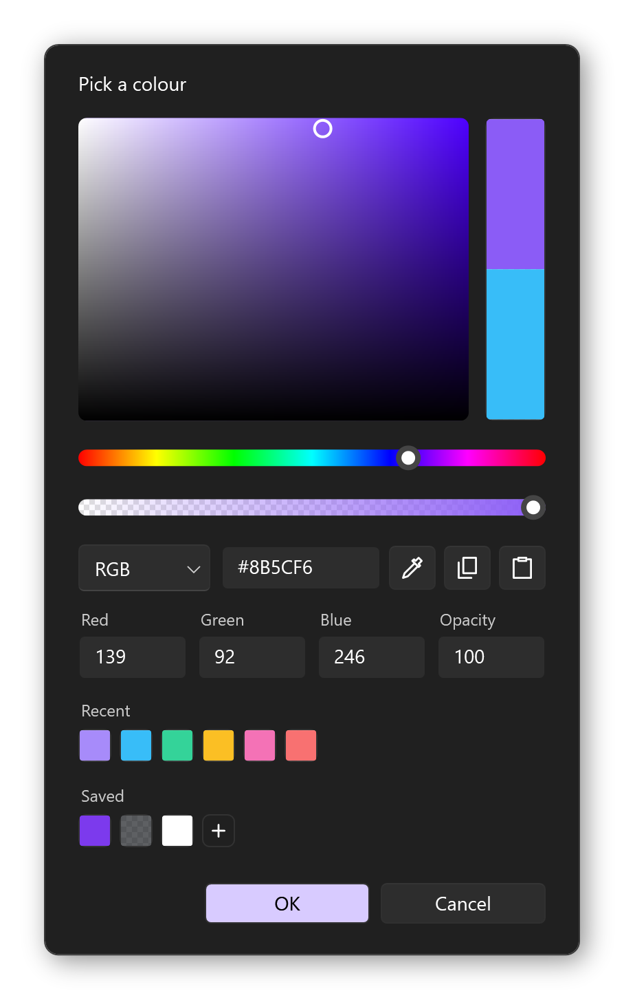

<h1 align="center"><b>RinColorPicker</b></h1>

<p align="center">
  A clean, fast colour picker for WPF that works on Windows, Linux and macOS.
</p>

<p align="center">
  
</p>

<p align="center">
  <a href="#adding-it-to-your-project">Get started</a> |
  <a href="https://github.com/KloBraticc/Voidstrap">Voidstrap</a> |
  <a href="LICENSE">License</a>
</p>

<div align="center">

[![License][shield-license]][link-license]
[![Stars][shield-repo-stars]][repo-stargazers]
[![Last commit][shield-last-commit]][repo-commits]

</div>

<h5 align="center">
  Leave a star if you like the project! ⭐️
</h5>

<p align="center">
  <picture><source media="(prefers-color-scheme: dark)" srcset="assets/readme/windows-tile-dark.svg"></picture>
  &nbsp;&nbsp;
  
  &nbsp;&nbsp;
  <picture><source media="(prefers-color-scheme: dark)" srcset="assets/readme/macos-dark.svg"></picture>
</p>

---

> [!NOTE]
> RinColorPicker is the colour picker used across [Voidstrap](https://github.com/KloBraticc/Voidstrap). It is plain WPF with no other dependencies, so it drops into any WPF app.

## Features

- **Saturation and brightness square** with separate **hue** and **opacity** sliders
- **RGB, HSV and HSL** inputs plus a **hex** box that accepts 3, 4, 6 or 8 digits
- **Old and new preview**, click the old colour to put it back
- **Copy and paste** hex codes
- **Recent and saved swatches**, right click a saved colour to remove it
- **Eyedropper** on every platform: live preview on Windows, the desktop portal on Linux (Wayland and X11), the system loupe on macOS
- **Keyboard friendly**: arrow keys nudge the square, sliders and number boxes, hold Shift for bigger steps
- **Translatable**: every label comes from a text provider you can swap out
- **Theme aware**: follows [WPF UI](https://github.com/lepoco/wpfui) theme brushes when they are present
- Smooth on slow renderers: brushes are reused and text boxes refresh at most once per frame while dragging

## Usage

<details>
  <summary><picture><source media="(prefers-color-scheme: dark)" srcset="assets/readme/setup-dark.svg"></picture><picture></picture></summary>

Add the repository as a submodule:

```bash
git submodule add https://github.com/KloBraticc/RinColorPicker external/RinColorPicker
```

Then reference the project from your app:

```xml
<ProjectReference Include="external\RinColorPicker\src\RinColorPicker\RinColorPicker.csproj" />
```

Apps that run on Linux and macOS through LibreWPF reference `RinColorPicker.Cross.csproj` instead.

</details>

<details>
  <summary><picture><source media="(prefers-color-scheme: dark)" srcset="assets/readme/usage-dark.svg"></picture><picture></picture></summary>

In XAML:

```xml
<Window xmlns:rin="clr-namespace:RinColor;assembly=RinColorPicker">
  <rin:RinColorPicker SelectedColor="{Binding AccentColor, Mode=TwoWay}" AlphaEnabled="True" />
</Window>
```

In code:

```csharp
using RinColor;

var picker = new RinColorPicker
{
    SelectedColor = Colors.MediumPurple,
    AlphaEnabled = false
};
picker.ColorChanged += OnColorChanged;
```

| Member | What it does |
| --- | --- |
| `SelectedColor` | The chosen colour, binds two way |
| `AlphaEnabled` | Shows the opacity slider and box |
| `SwatchesEnabled` | Shows the recent and saved rows |
| `OriginalColor` | The colour shown in the lower preview half |
| `ColorChanged` | Raised whenever the colour changes |
| `RememberSelection()` | Adds the current colour to the recent row, call it when the user confirms |

`RinColorMath` is public too, for HSV, HSL and hex conversion in your own code.

</details>

<details>
  <summary><picture><source media="(prefers-color-scheme: dark)" srcset="assets/readme/hooks-dark.svg"></picture><picture></picture></summary>

Everything app specific plugs in through static hooks, so the library never needs to know about your app.

```csharp
RinColorPickerText.Provider = () => new RinColorPickerText
{
    Red = Strings.Red,
    Hue = Strings.Hue,
    Alpha = Strings.Opacity
};

RinColorSwatches.Store = new MySettingsSwatchStore();

RinColorClipboard.GetText = MyClipboard.GetText;
RinColorClipboard.SetText = MyClipboard.SetText;

RinScreenSampler.Picker = new MyPortalColorPicker();
```

| Hook | Default |
| --- | --- |
| `RinColorPickerText.Provider` | English labels, read each time the picker refreshes so language changes apply live |
| `RinColorSwatches.Store` | In memory, subclass `RinColorSwatchMemoryStore` and override `OnChanged` to save |
| `RinColorClipboard` | The WPF clipboard |
| `RinScreenSampler.Current` | Live screen sampling on Windows, `null` elsewhere |
| `RinScreenSampler.Picker` | `null`, set a one shot system picker for Linux or macOS |

The eyedropper button only appears when a sampler or an available picker is set, so it never shows when it cannot work.

</details>

<details>
  <summary><picture><source media="(prefers-color-scheme: dark)" srcset="assets/readme/platforms-dark.svg"></picture><picture></picture></summary>

| | Windows | Linux | macOS |
| --- | --- | --- | --- |
| Picker, inputs and swatches | ✓ | ✓ | ✓ |
| Copy and paste | ✓ | ✓ | ✓ |
| Eyedropper | Live preview, click to pick, Esc to cancel | `org.freedesktop.portal.Screenshot` `PickColor`, Wayland and X11 | `NSColorSampler` loupe |

On Linux and macOS the eyedropper is provided by the host app through `RinScreenSampler.Picker`. Voidstrap ships both implementations and can be used as a reference.

</details>

<details>
  <summary><picture><source media="(prefers-color-scheme: dark)" srcset="assets/readme/building-dark.svg"></picture><picture></picture></summary>

You need the [.NET 10 SDK](https://dotnet.microsoft.com/download/dotnet/10.0).

```bash
dotnet build src/RinColorPicker/RinColorPicker.csproj
```

The library builds with warnings treated as errors.

</details>

## Built With

[![C#][shield-csharp]][link-csharp] [![.NET][shield-dotnet]][link-dotnet] [![WPF][shield-wpf]][link-wpf]

## License

[![License][shield-license]][link-license]

RinColorPicker is released under the [MIT License](LICENSE). The Windows and macOS icons in this README are from [Voidstrap](https://github.com/KloBraticc/Voidstrap) and the Linux icon is from [Devicon](https://github.com/devicons/devicon) (MIT).

[shield-license]:      https://img.shields.io/github/license/KloBraticc/RinColorPicker?style=for-the-badge
[shield-repo-stars]:   https://img.shields.io/github/stars/KloBraticc/RinColorPicker?color=ffd700
[shield-last-commit]:  https://img.shields.io/github/last-commit/KloBraticc/RinColorPicker?color=8a2be2
[shield-csharp]:       https://img.shields.io/badge/C%23-239120?style=for-the-badge
[shield-dotnet]:       https://img.shields.io/badge/.NET-512BD4?style=for-the-badge&logo=dotnet&logoColor=white
[shield-wpf]:          https://img.shields.io/badge/WPF-0078D4?style=for-the-badge

[link-license]:        https://github.com/KloBraticc/RinColorPicker/blob/main/LICENSE
[repo-stargazers]:     https://github.com/KloBraticc/RinColorPicker/stargazers
[repo-commits]:        https://github.com/KloBraticc/RinColorPicker/commits/main
[link-csharp]:         https://learn.microsoft.com/dotnet/csharp/
[link-dotnet]:         https://dotnet.microsoft.com/
[link-wpf]:            https://learn.microsoft.com/dotnet/desktop/wpf/
